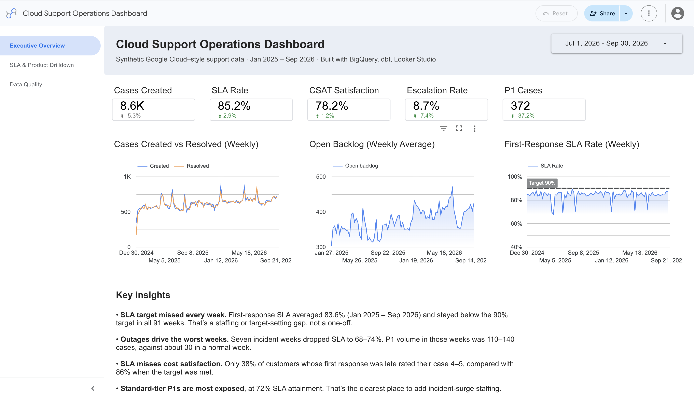
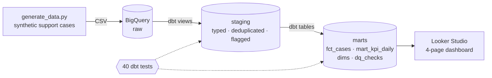

# Cloud Support Operations Analytics

**BigQuery · dbt · Looker Studio · Python**

An end-to-end BI project that turns raw support-case data into a single source of truth for Cloud Support KPIs: case volume, backlog, first-response SLA attainment, resolution time, escalations and customer satisfaction (CSAT). It ends in a four-page leadership dashboard.

### 📊 [View the live dashboard →](https://datastudio.google.com/reporting/03a7604c-8fe8-441f-a1f2-65278cf8f1f9)



---

## Why this project

Support leaders need one trusted answer to "are we meeting our SLAs, and where are we falling short?" When different reports define a metric differently, teams argue about the numbers instead of fixing the problem. This project shows how I approach that problem:

- **Define each metric once** ([METRICS.md](METRICS.md)), in dbt, so every chart and filter returns the same answer.
- **Make data quality visible.** Bad rows are counted and handled, never silently dropped.
- **Lead with findings.** The dashboard opens with KPIs and trends, then states what they mean and what to do.

## Architecture



| Layer | What happens |
|---|---|
| **raw** | CSVs loaded with `bq load`. Every column is STRING, so the source is preserved exactly, bad values included. |
| **staging** | Types cast with `SAFE` parsing. Duplicate cases removed deterministically (cleanest copy kept). Data quality issues flagged, not deleted. |
| **marts** | `fct_cases` (one row per case with SLA, duration and CSAT measures), `mart_kpi_daily` (the daily KPI single source of truth), dimension tables, and a `dq_checks` scorecard. |
| **dashboard** | Looker Studio reads only from marts. Rates are recalculated from stored numerators and denominators, so they stay correct at any grain. |

## Dashboard

| Page | Purpose |
|---|---|
| **Executive Overview** | Current-quarter KPIs vs the previous quarter, weekly volume / backlog / SLA trends, and key insights. |
| **SLA & Product Drilldown** | SLA by product, a support tier × priority heatmap, and a product scorecard, with filters for product, priority, tier and region. |
| **Data Quality** | Every data quality check, how many rows failed, and how each issue is handled. |

## Key findings

- **The SLA target was missed every week.** First-response SLA averaged **83.6%** (Jan 2025 – Sep 2026) and stayed below the 90% target in all 91 weeks. That points to a structural staffing or target-setting gap, not a one-off.
- **Outages drive the worst weeks.** Seven incident weeks dropped SLA to **68–74%**, with 110–140 P1 cases against about 30 in a normal week.
- **P1 is the weakest priority in every tier**, and **Standard-tier P1 is the worst at 72%**. That's the clearest place for incident-surge staffing.
- **Product isn't the driver.** All nine products fall within 82–85% SLA.
- **SLA misses cost satisfaction.** 38% of customers with a late first response rated their case 4–5, compared with 86% when the target was met. *(This relationship is modeled in the synthetic data; with real data, I'd validate it before acting on it.)*

## Data quality

The source data contains planted defects. Each one is caught, counted and handled:

| Check | Failed rows | Handling |
|---|---|---|
| Missing assigned agent | 451 | Kept; reported as "Unassigned" |
| Duplicate case rows | 226 | Removed in staging (cleanest copy kept) |
| Resolved before created | 112 | Kept; excluded from resolution time and backlog |
| CSAT score outside 1–5 | 50 | Excluded from CSAT metrics |
| Survey with no matching case | 33 | Excluded from CSAT metrics |

**Tests:** 40 dbt tests run on every build. They cover uniqueness, not-null, accepted values and referential integrity, plus custom tests that check no durations are negative, backlog never goes below zero, and **the daily KPI mart reconciles exactly to the case-level fact table**. Source-level tests are set to *warn* (the defects are expected there), and mart-level tests must *pass*.

## Design decisions

- **Deterministic deduplication.** Some duplicate rows differ: one copy is missing its agent, or has a bad timestamp. Early runs picked a copy arbitrarily, so data quality counts shifted between runs. Staging now always keeps the cleanest copy and breaks remaining ties on the full row, so every run returns identical numbers.
- **Trends cut off at the last full week.** Including the partial final week made volume look like it collapsed, and inflated SLA, because recent cases still waiting for a first response drop out of the calculation (survivorship bias).
- **Ratios stored as parts.** `mart_kpi_daily` stores numerators and denominators, not just rates. Averaging daily rates would give a quiet Sunday the same weight as a busy Monday.
- **BigQuery sandbox constraints.** The sandbox expires partitions 60 days after their partition date, so `fct_cases` is clustered by product and priority rather than partitioned. In production, I'd partition by `DATE(created_at)`. The sandbox also doesn't allow DML, so models are full rebuilds (`CREATE OR REPLACE`) instead of incremental `MERGE`s.

## Data

All data is **synthetic**: about 57K Google Cloud–style support cases from Jan 2025 to Sep 2026, across 9 products, 3 support tiers, 140 agents and 1,800 customers. No public dataset contains real enterprise support tickets, so [`generate_data.py`](generate_data.py) simulates realistic patterns (weekday seasonality, growth, incident spikes, tier-based SLA targets) and plants known data quality defects. See [DATA.md](DATA.md).

## Run it yourself

Requirements: Python 3.10–3.13, the Google Cloud CLI, and a GCP project (the free BigQuery sandbox works).

```bash
# 1. Generate data and load it into BigQuery
python3 generate_data.py --out data
./load_raw.sh YOUR_PROJECT_ID

# 2. Install dbt and connect
python3 -m venv .venv && source .venv/bin/activate
pip install "dbt-core>=1.10,<2" "dbt-bigquery>=1.10,<2"
gcloud auth application-default login
mkdir -p ~/.dbt && cp profiles.example.yml ~/.dbt/profiles.yml   # set your project ID

# 3. Build models and run tests
dbt build
```

## Project structure

```
├── generate_data.py          # synthetic data generator (seeded, reproducible)
├── load_raw.sh               # loads CSVs into the BigQuery raw dataset
├── models/
│   ├── staging/              # typed, deduplicated, flagged views + source tests
│   └── marts/                # fct_cases, mart_kpi_daily, dims, dq_checks
├── tests/                    # custom tests (reconciliation, no negative durations/backlog)
├── macros/                   # dataset naming
├── METRICS.md                # single source of truth for metric definitions
└── DATA.md                   # data description and planted defects
```

## Next steps

- Schedule `dbt build` daily with GitHub Actions.
- Switch large models to incremental `MERGE` loads with partitioning, once off the sandbox.
- Rebuild the semantic layer in Looker (LookML) so metrics are governed in the BI tool as well as in dbt.

---

Built by **Vikram Sharma** · [LinkedIn](https://linkedin.com/in/vikramdata) · [Portfolio](https://vikramdata.github.io)
